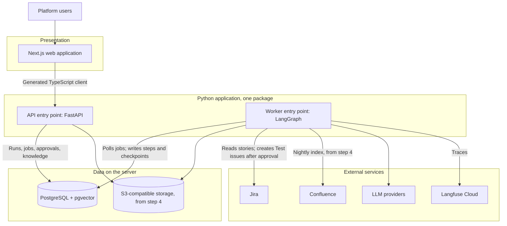
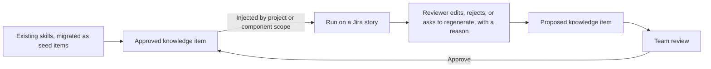
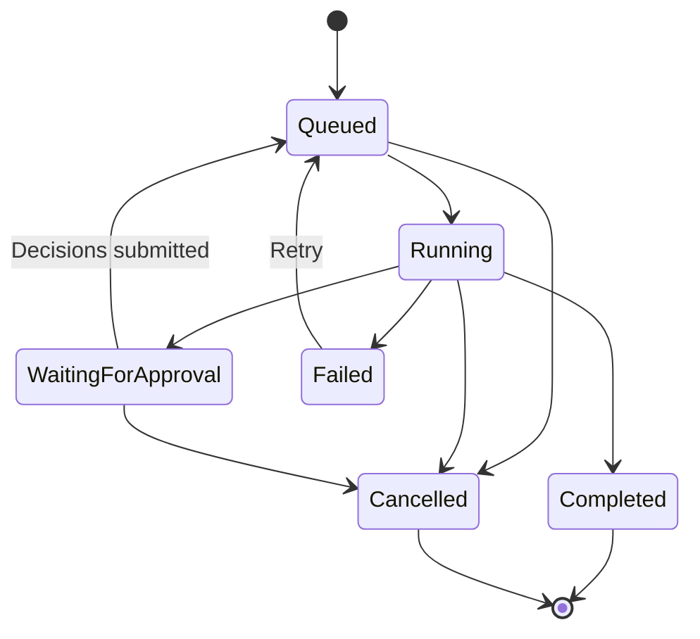
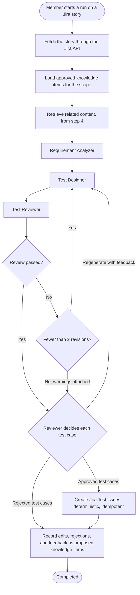

# QualiForge AI — Architecture Blueprint

**Version:** 0.2.0\
**Last updated:** 2026-11-20\
**Status:** Baseline with decisions ADR-001 to ADR-020 applied\
**Repository:** `qualiforge-ai`\
**Decisions:** `docs/architecture/ARCHITECTURE_DECISIONS.md`\
**Open questions:** `docs/architecture/OPEN_QUESTIONS.md`\
**Previous version:** 0.1.0, git tag `architecture-v0.1.0`

---

## How to read this document

This document describes what QualiForge AI is and how it is built. `ARCHITECTURE_DECISIONS.md` records why: each decision there has its reasoning, its source, and the condition that would reopen it. Sections here cite decisions by ID instead of repeating the reasoning.

Where the two documents disagree, `ARCHITECTURE_DECISIONS.md` wins, and the disagreement is a defect in this document.

Items marked **Later** or **Deferred** are part of the long-term direction but not of the MVP. The deferred list, with the condition that brings each item back, is in the Deferred section of `ARCHITECTURE_DECISIONS.md`.

### Versioning

| Change                                                   | Version bump             |
| -------------------------------------------------------- | ------------------------ |
| Wording, typo, or diagram fix with no change in meaning  | Patch, for example 0.2.1 |
| New or changed decisions applied to this document        | Minor, for example 0.3.0 |
| Every item in section 15 (architecture readiness) is met | 1.0.0                    |
| A later change that replaces a 1.x design                | Major, for example 2.0.0 |

Each version adds a row to the history below. Once a version is merged to `main`, its commit is tagged `architecture-v<version>`, so documents that cite a version can be read as they were.

### Version history

| Version | Date       | Summary                                                                                                                                                                                                                                                                                                                                                    |
| ------- | ---------- | ---------------------------------------------------------------------------------------------------------------------------------------------------------------------------------------------------------------------------------------------------------------------------------------------------------------------------------------------------------- |
| 0.2.0   | 2026-11-20 | Applied ADR-001 to ADR-020. Added curated knowledge and the feedback loop, the run lifecycle, and the order of work. Removed Redis, Prometheus, Grafana, OpenTelemetry, the BFF option, and the provider layer from the MVP. Moved open questions to `OPEN_QUESTIONS.md` and the review protocol to `docs/prompts/ARCHITECTURE_REVIEW_PROTOCOL.prompt.md`. |
| 0.1.0   | 2026-11-10 | First proposal, reviewed in `docs/reviews/2026-11-10-claude-architecture-review.md` and `docs/reviews/2026-11-10-gemini-architecture-review.md`.                                                                                                                                                                                                           |

---

## 1. Project Vision

QualiForge AI is an AI-powered Quality Engineering platform that helps software testing teams improve software quality through context-aware AI agents.

The platform connects requirements, product documentation, test cases, and team testing knowledge to AI-driven testing workflows. The goal is not only to generate test cases with an LLM. It is a shared place where a team runs workflows, sees inside each run, compares releases, and turns reviewer corrections into knowledge that improves later runs.

### 1.1 Problems the MVP solves

UC-01 (Jira story to reviewed test cases) already works today as a Claude coding agent plus skills, on one machine. The platform exists because that setup has four gaps:

1. The team cannot run the workflow from a shared place.
2. A run cannot be inspected step by step.
3. One release of the workflow cannot be compared with the last.
4. The only way to improve the agent is to edit skills; reviewer corrections are lost.

Langfuse covers the second and third (ADR-007). Curated knowledge and the feedback loop cover the fourth (ADR-011), and are the main reason for the platform.

### 1.2 Project context

The platform is built by one SDET at about 20 hours per week, for an internal QA team of 5 to 10 people, on one internal server with Docker Compose. Multi-tenant SaaS, cloud scaling, and more than about 10 users are not goals. The full context table is in the Project context section of `ARCHITECTURE_DECISIONS.md`.

### 1.3 Main objectives

- Let the team run AI testing workflows from one shared application.
- Generate and review test cases using project knowledge, not only the model's general knowledge.
- Turn reviewer edits, rejections, and feedback into curated team knowledge.
- Show what happened inside each run, with tokens, cost, and prompt versions.
- Compare workflow releases on a fixed evaluation dataset.
- Keep traceability from a Jira story to the test issues created from it.
- **Later:** analyze existing tests, generate Playwright and unit tests, and integrate with Xray, GitHub, and CI/CD.

### 1.4 Guiding principles

1. **Knowledge before generation:** Agents use relevant, traceable project knowledge rather than only the model's general knowledge.
2. **Knowledge grows from review:** Corrections made by reviewers become shared knowledge, not prompt edits.
3. **Human-in-the-loop:** No AI output reaches an external system without human approval.
4. **Provider independence:** The code is not tied to one LLM provider, without building a custom provider layer (ADR-017).
5. **Observable by design:** Every run, step, and LLM call is traceable.
6. **Source of truth preservation:** Jira and Confluence remain authoritative for their data.
7. **Simplest architecture that fits the current scale:** Add a service only when a measured need appears. Each deferred item has a condition that brings it back.
8. **Security by design:** Accounts, encrypted credentials, and write restrictions exist from the first version.

---

## 2. Target Users and Use Cases

### 2.1 Target users

| User                   | Main responsibilities                                    | Platform role |
| ---------------------- | -------------------------------------------------------- | ------------- |
| QA Engineer            | Run workflows; review, edit, and approve test cases      | Member        |
| QA Lead / Test Manager | Follow runs, approve knowledge items, compare releases   | Member        |
| Platform Administrator | Configure integrations and credentials, manage accounts  | Administrator |
| Automation Engineer    | **Later:** generate and maintain automated tests (UC-03) | Member        |
| Developer              | **Later:** improve unit tests (UC-04)                    | Member        |

Roles are defined in ADR-015.

### 2.2 Use cases

| ID    | Use case                                | Status                  |
| ----- | --------------------------------------- | ----------------------- |
| UC-01 | Jira user story to reviewed test cases  | MVP, steps 1 to 3       |
| UC-02 | Existing test case analysis             | Later (ADR-020, step 5) |
| UC-03 | Jira test case to Playwright automation | Later, needs a sandbox  |
| UC-04 | Pull request unit test generation       | Later, needs a sandbox  |
| UC-05 | Knowledge discovery                     | Not scheduled           |

**UC-01: Jira user story to reviewed test cases**

1. A member starts a run on a Jira story.
2. The platform fetches the story through the Jira API (ADR-006).
3. The platform loads the approved knowledge items for the story's scope (ADR-011).
4. From step 4 of the roadmap: related content is retrieved from the index, starting with existing tests for duplicate detection (ADR-006).
5. The Requirement Analyzer, Test Designer, and Test Reviewer produce test cases. The reviewer can send work back to the designer at most twice (ADR-003).
6. A reviewer decides each test case: approve, regenerate with feedback, or reject. Test cases can be edited inline (ADR-013).
7. A deterministic step creates one Jira Test issue per approved test case, linked to the story (ADR-012, ADR-014).
8. Edits, rejections, and feedback become proposed knowledge items (ADR-011).
9. The run, its steps, and a link to its Langfuse trace are recorded (ADR-007).

**UC-02: Existing test case analysis (Later)**

- Retrieve existing tests.
- Find duplicates, missing coverage, and quality issues.
- Recommend updates or removals for human approval.

**UC-03: Jira test case to Playwright automation (Later)**

- Evaluate automation feasibility of a manual test.
- Analyze the target application and the existing automation framework.
- Generate Playwright code, run it, and open a pull request for review.

UC-03 and UC-04 run generated code, so they need an isolated sandbox first.

**UC-04: Pull request unit test generation (Later)**

- Analyze changed production code and its existing unit tests.
- Generate unit tests, run them with linting and coverage, and publish the result.

**UC-05: Knowledge discovery (Not scheduled)**

- Search across indexed sources and answer with source references.

---

## 3. High-Level Architecture

### 3.1 Architecture overview

The platform is one web application and one Python application, deployed as containers on one server.

| Component        | Technology                      | Responsibility                                                         | Decision         |
| ---------------- | ------------------------------- | ---------------------------------------------------------------------- | ---------------- |
| Web application  | Next.js + TypeScript            | User interface only; calls the API through a generated client          | ADR-001          |
| API              | Python + FastAPI                | Accounts, runs, approvals, knowledge items, configuration              | ADR-002          |
| Worker           | Python + LangGraph              | Executes runs; same package as the API, second entry point             | ADR-002, ADR-003 |
| Database         | PostgreSQL + pgvector           | Business data, jobs table, LangGraph checkpoints, full-text and vector | ADR-004, ADR-005 |
| Object storage   | S3-compatible container         | Uploaded documents; added in step 4                                    | ADR-009          |
| AI observability | Langfuse Cloud                  | Traces, tokens, cost, prompt versions, datasets, release comparison    | ADR-007          |
| External systems | Jira, Confluence, LLM providers | Source of stories and documents; target for Test issues                | ADR-006, ADR-012 |

### 3.2 Logical architecture



### 3.3 Responsibilities of the API and the worker

The API owns everything a user acts on: accounts, credentials, runs, approvals, knowledge items, and the policy for writes to external systems. LangGraph owns the steps inside one run. The API never executes a workflow inside an HTTP request; it inserts a job and returns.

Inside the Python package, the main modules are:

| Module       | Contents                                                                    |
| ------------ | --------------------------------------------------------------------------- |
| Accounts     | Local accounts, roles, the single current-user function (ADR-015)           |
| Integrations | Jira and Confluence clients, encrypted credential storage (ADR-016)         |
| Runs         | Runs, steps, jobs table, approvals, test cases and their edits              |
| Workflows    | LangGraph graphs and agents (ADR-003, ADR-019)                              |
| Knowledge    | Curated knowledge items; from step 4, indexing and retrieval (ADR-006, 011) |

Knowledge is a module of the application, not a separate service.

---

## 4. Technology Stack

| Area                      | Technology                               | Status                    |
| ------------------------- | ---------------------------------------- | ------------------------- |
| Frontend                  | Next.js + TypeScript                     | Decided (ADR-001)         |
| Backend API and worker    | FastAPI, one Python package              | Decided (ADR-002)         |
| Agent orchestration       | LangGraph, PostgreSQL checkpointer       | Decided (ADR-003)         |
| Database                  | PostgreSQL                               | Decided (ADR-004)         |
| Search                    | pgvector and PostgreSQL full-text        | Decided (ADR-004)         |
| Job dispatch              | PostgreSQL jobs table                    | Decided (ADR-005)         |
| Object storage            | S3-compatible container                  | Decided, step 4 (ADR-009) |
| LLM access                | LangGraph ecosystem chat model interface | Decided (ADR-017)         |
| LLM observability         | Langfuse Cloud                           | Decided (ADR-007)         |
| Infrastructure monitoring | Container health checks and logs         | Decided (ADR-008)         |
| Containerization          | Docker Compose                           | Decided (ADR-010)         |
| CI/CD                     | GitHub Actions                           | Proposed                  |
| Queue                     | Redis                                    | Deferred (ADR-005)        |
| Telemetry                 | Separate OpenTelemetry collector         | Not used (ADR-007)        |
| Metrics and dashboards    | Prometheus + Grafana                     | Deferred (ADR-008)        |

### 4.1 Frontend: Next.js

Next.js is the presentation layer only. It holds no business logic and is not a backend-for-frontend. It calls FastAPI through a TypeScript client generated from the OpenAPI specification, so the build fails when the two disagree (ADR-001).

MVP screens:

- Sign-in and account administration.
- Integration configuration (administrators only).
- Run list: completed, running, and waiting for approval.
- Run page: steps, status, and a link to the Langfuse trace.
- Approval: per test case review, inline edit, approve, regenerate with feedback, reject.
- Knowledge items: review and approval of proposed items (step 3).
- Document upload (step 4).

Trace, cost, and release comparison views are not rebuilt; the platform links to Langfuse.

### 4.2 Backend: FastAPI

All Python code is one package with two entry points, the API and the worker (ADR-002). They share models and database access.

Responsibilities:

- REST API and OpenAPI specification.
- Authentication and roles.
- Run lifecycle: create, queue, cancel, resume after approval.
- Approval records and test case edits.
- Knowledge items.
- Integration configuration and credential encryption.
- Audit fields: who started, who approved, who authored.

### 4.3 Agent orchestration: LangGraph

Workflows are fixed LangGraph graphs with explicit edges. No agent chooses another agent. The checkpointer stores state in PostgreSQL, so an approval can wait for days without holding a worker (ADR-003).

Prefer deterministic code and direct API calls where they are enough. An LLM step is used only for interpretation, design, and review.

### 4.4 LLM providers

There is no custom provider abstraction and no proxy. The platform uses the chat model interface from the LangGraph ecosystem, with one primary provider and one fallback. Token and cost figures come from Langfuse (ADR-017).

### 4.5 Observability

Langfuse Cloud is the only observability tool. Section 8 describes what is recorded.

---

## 5. Knowledge System

### 5.1 Two kinds of knowledge

| Kind                      | What it is                                                         | How a run gets it                           | When built   |
| ------------------------- | ------------------------------------------------------------------ | ------------------------------------------- | ------------ |
| Curated knowledge items   | Small, team-written rules and corrections, with author and version | Injected by scope, without vector search    | Steps 2 to 3 |
| Indexed reference content | Confluence pages, existing tests, uploaded documents               | Retrieved by search to find related content | Step 4       |

A record whose ID is already known, such as the Jira story a run starts from, is always fetched through the source system's API. Retrieval is used only to discover related content (ADR-006).

### 5.2 Curated knowledge and the feedback loop

This is the main reason for the platform (ADR-011).



Each knowledge item records:

- Scope: project or component.
- Author.
- Status: proposed or approved.
- Version.
- Origin: the run or the uploaded document it came from.

When approved items become too many to inject by scope, they move into retrieval.

### 5.3 Indexed reference content (step 4)

| Source                    | Content                                  | How it enters the index       |
| ------------------------- | ---------------------------------------- | ----------------------------- |
| Jira                      | Stories and existing Test issues         | Allowlisted projects, nightly |
| Confluence                | Specifications and testing guidelines    | Allowlisted spaces, nightly   |
| Uploaded documents        | `.md` and text-based `.pdf` files        | On upload                     |
| Xray, GitHub, other files | Test sets, executions, code, Word, Excel | Deferred                      |

Rules:

- Indexed sources are an explicit allowlist of Jira projects and Confluence spaces.
- The allowlist is re-indexed in full every night. A content hash skips re-embedding of unchanged documents. Deleted documents disappear at the next re-index.
- Scanned PDFs are rejected with a clear message (ADR-009).
- There is no per-user permission filtering. Access goes through shared credentials, so every platform user can see everything the configured credentials can see (ADR-016).
- Atlassian Cloud cannot deliver webhooks to the internal server, so there is no webhook sync.

The first use of retrieval is duplicate detection against existing tests. Retrieval is extended only where the evaluation shows a gap that curated knowledge does not fill.

### 5.4 Storage

| Store                 | Holds                                                                       |
| --------------------- | --------------------------------------------------------------------------- |
| PostgreSQL            | Knowledge items, source metadata, chunks, content hashes, full-text indexes |
| pgvector              | Chunk embeddings                                                            |
| S3-compatible storage | Original uploaded files                                                     |

### 5.5 Retrieval

From step 4, retrieval combines:

1. Exact identifier lookup.
2. PostgreSQL full-text search.
3. pgvector semantic search.
4. Metadata filtering, such as project and source.
5. Context construction for the prompt.

Reranking is deferred.

---

## 6. Agent Architecture

### 6.1 Agent design

An agent is a Python module (ADR-019). Each agent defines:

- Name and description.
- Input and output schema.
- Prompt, managed in Langfuse by name and version.
- Model configuration.
- Tools. LLM steps get read-only tools; they never write to external systems (ADR-014).
- Timeout and retry policy.

An agent's version is the git commit plus the Langfuse prompt version. Both are recorded on each run. There are no agent or workflow registries in the MVP.

### 6.2 Agent catalog

| Agent                        | Responsibility                                  | Status |
| ---------------------------- | ----------------------------------------------- | ------ |
| Requirement Analyzer         | Analyze the story and its acceptance criteria   | MVP    |
| Test Designer                | Design test scenarios and test cases            | MVP    |
| Test Reviewer                | Check completeness, correctness, and duplicates | MVP    |
| Automation Feasibility Agent | Assess whether a manual test can be automated   | Later  |
| Playwright Generator         | Generate Playwright automation code             | Later  |
| Unit Test Generator          | Generate unit tests from code changes           | Later  |
| Unit Test Reviewer           | Review generated unit tests                     | Later  |

Loading knowledge items and retrieving related content are deterministic steps, not agents.

### 6.3 Run lifecycle

A run is one execution of one workflow on one Jira story, started by one member.



The execution model provides:

- Asynchronous execution through the jobs table (ADR-005).
- Checkpoints in PostgreSQL; a worker restart resumes the run from its last checkpoint.
- An approval wait that holds no worker and no HTTP request, for as long as it takes.
- Run duration that excludes time spent waiting for approval (ADR-013).
- Retries that never duplicate Jira writes (ADR-014).
- Cancellation.
- A step record for each step (section 8.2).

---

## 7. Workflow Architecture

A workflow is a fixed LangGraph graph, versioned with the code.

### 7.1 UC-01: Jira story to Jira Test issues



### 7.2 Workflow rules

- Fixed graphs with explicit edges. No agent chooses another agent (ADR-003).
- The reviewer-to-designer loop is capped at 2 revisions. After that the run goes to human approval with the reviewer's warnings attached.
- Approval is per test case. The original and the edited version of each test case are both stored (ADR-013).
- Workflow version is the git commit plus the prompt versions used (ADR-019).

### 7.3 Deterministic versus agentic steps

Deterministic code is used for:

- Fetching Jira issues by ID.
- Loading knowledge items.
- Validating schemas.
- Checking roles and approval state.
- Creating Jira Test issues.
- Persisting run and step records.

LLM steps are used for:

- Requirement interpretation.
- Test design.
- Semantic review.

LLM steps have no write tools. Writes to Jira happen only in a deterministic step after human approval. This is the practical defence against prompt injection from retrieved or uploaded content (ADR-014).

### 7.4 Jira Test issues

The MVP writes generated tests as Jira issues of type Test, linked to the user story. The Xray API is not used (ADR-012).

- Steps go in the issue description, in Atlassian Document Format, following one fixed template with bold section headings such as **Preconditions** and **Steps**. A later move to Xray steps can parse it.
- Labels identify the origin: `qualiforge`, `llm-provider-<provider>`, `llm-model-<name>`.
- The description carries the run ID, the approving user, and a link to the run.
- Each test case has an idempotency key and stores the Jira key it produced. A retry creates only the test issues not yet created (ADR-014).

The description template is still to be designed (`OPEN_QUESTIONS.md`).

---

## 8. AI Observability and Evaluation

### 8.1 Where data lives

| Data                                                 | Store          |
| ---------------------------------------------------- | -------------- |
| Runs, steps, approvals, test cases, knowledge items  | PostgreSQL     |
| Step records: name, status, inputs, outputs, tokens  | PostgreSQL     |
| Full traces, token and cost figures, prompt versions | Langfuse Cloud |
| Evaluation datasets and release comparisons          | Langfuse Cloud |

PostgreSQL is the source of truth for business state. The run list and run page work when Langfuse is unavailable. Each run links to its Langfuse trace (ADR-007).

### 8.2 Monitoring hierarchy

```text
Run
  ├── Step
  │     ├── LLM call
  │     ├── Tool call
  │     └── Retrieval operation (from step 4)
  └── Run summary
```

Recorded per level:

- **Run:** run ID, workflow and version, story key, member, start and end time, duration excluding approval wait, status, total tokens, estimated cost, retry count, Langfuse trace link.
- **Step:** name, status, inputs, outputs, tokens, duration.
- **LLM call (Langfuse):** provider, model, prompt version, input and output tokens, latency, cost, errors.
- **Retrieval (Langfuse, step 4):** query, retrieved document IDs, sources, scores, context size.
- **Quality:** review acceptance rate, edit rate, rejection rate, duplicate rate, evaluation dataset score per release.

### 8.3 Baseline and evaluation

The existing Claude-based workflow is the baseline (ADR-018).

1. Before the port, the existing workflow is traced into Langfuse.
2. A dataset of 20 to 30 real stories with their accepted test cases is built.
3. The LangGraph port must score at least as well as the baseline on that dataset.
4. The dataset is re-run for each release, and grows over time.

The pass criteria are still to be designed (`OPEN_QUESTIONS.md`).

### 8.4 Trace data

Traces contain story text and generated tests, so they leave the internal network. The owner accepted this on 2026-11-13 (ADR-007).

- Credentials are masked in traces (ADR-016).
- Self-hosting Langfuse later means changing the base URL and keys; traces and datasets already in the cloud project do not move automatically.

---

## 9. Security and Governance

### 9.1 Authentication and roles

Local accounts exist from the first version (ADR-015).

- Two roles: member and administrator. An administrator can promote other accounts.
- The first administrator is created from environment variables on first start.
- The system refuses to demote or delete the last administrator.
- The API obtains the current user through one function, so the login method can be replaced in one place when a company identity provider arrives.

### 9.2 Integration credentials

Jira and Confluence credentials are entered on a configuration page open to administrators only (ADR-016).

- Encrypted at rest with a key supplied through the environment.
- Never returned to the browser after saving.
- Masked in traces.
- Each integration has a "test connection" action.
- The page states that every platform user can see everything the configured credentials can see.

LLM provider and Langfuse keys are supplied through the environment.

### 9.3 AI governance

- Human approval before any external write (ADR-013, ADR-014).
- LLM steps have no write tools (ADR-014).
- Idempotent writes to Jira (ADR-014).
- Traceability from story to Test issue: run ID, approver, provider, and model on every issue (ADR-012).
- Prompt and workflow versions recorded on every run (ADR-019).
- Authorship and status recorded on every knowledge item (ADR-011).
- Schema validation of LLM output before it is stored.

**Deferred:** per-user access to source systems, project-level permissions, company single sign-on, per-team budgets.

---

## 10. Deployment Architecture

### 10.1 Deployment

Docker Compose on one internal server with 16 GB RAM and 100 GB disk (ADR-010).

| Service        | Container                | From   |
| -------------- | ------------------------ | ------ |
| Web            | Next.js                  | Step 2 |
| API            | FastAPI                  | Step 2 |
| Worker         | Same image, worker entry | Step 2 |
| Database       | PostgreSQL + pgvector    | Step 2 |
| Object storage | S3-compatible container  | Step 4 |

Langfuse is not in the compose file while the project uses Langfuse Cloud. Self-hosted Langfuse recommends at least 16 GiB of memory for itself, so self-hosting needs more memory or a second machine (ADR-007).

### 10.2 Execution flow

1. A member starts a run in the web application.
2. FastAPI checks the request, creates the run, and inserts a job row.
3. The worker polls the jobs table and claims the job.
4. LangGraph runs the graph, writing a step record and a checkpoint after each step, and sending traces to Langfuse.
5. At the approval step the graph interrupts. The run waits for approval and the worker is released.
6. The web application polls the run status every few seconds.
7. The reviewer submits decisions. FastAPI stores them and inserts a resume job.
8. The worker resumes the run from its checkpoint, creates the approved Jira Test issues, and records feedback.
9. The run completes and its results appear in the run list.

### 10.3 Operations

- Container health checks and logs replace Prometheus and Grafana (ADR-008).
- Backup of the application database and the document bucket is still to be designed (`OPEN_QUESTIONS.md`). The knowledge base and uploaded documents are the only data that cannot be regenerated.

### 10.4 Future deployment

The architecture should allow more workers or a move to other infrastructure without changing workflow contracts. Kubernetes, Temporal, and other complex infrastructure are not introduced until a measured need justifies them.

---

## 11. Repository Structure

One Next.js application and one Python package with two entry points (ADR-002). The structure below is the target; exact paths are fixed when the code starts.

```text
qualiforge-ai/
├── apps/
│   ├── web/                  # Next.js application
│   └── api/                  # Python package: API and worker entry points
│       └── qualiforge/
│           ├── accounts/
│           ├── integrations/
│           ├── runs/
│           ├── workflows/    # LangGraph graphs and agents
│           └── knowledge/
├── docs/
│   ├── architecture/
│   │   ├── ARCHITECTURE.md
│   │   ├── ARCHITECTURE_DECISIONS.md
│   │   └── OPEN_QUESTIONS.md
│   ├── development/
│   ├── prompts/
│   └── reviews/
├── docker-compose.yml
├── .env.example
└── README.md
```

Prompts are managed in Langfuse, not in the repository. Agent and workflow definitions are Python code, not separate definition packages.

---

## 12. Implementation Roadmap

The order of work is ADR-020. Each step ends with something a user can see and removes one technical risk.

| Step                    | Work                                                                                                                                                    | Risk removed                                                                            |
| ----------------------- | ------------------------------------------------------------------------------------------------------------------------------------------------------- | --------------------------------------------------------------------------------------- |
| 1. Baseline             | Trace the existing Claude workflow into Langfuse Cloud. Build the evaluation dataset.                                                                   | Whether the rebuild can be measured.                                                    |
| 2. Walking skeleton     | Accounts, configuration page, run page, run list, UC-01 on LangGraph, approval, idempotent Jira test creation. Knowledge is the migrated skill content. | Whether the port matches the baseline. Whether checkpoint and approval work end to end. |
| 3. Feedback loop        | Capture of edits and rejections, review and approval of knowledge items, dataset re-run per release.                                                    | Whether curated knowledge measurably improves output.                                   |
| 4. Retrieval and upload | Upload and indexing of `.md` and text-based `.pdf` files. Indexing of Confluence and existing tests, starting with duplicate detection.                 | Whether retrieval adds value beyond curated knowledge.                                  |
| 5. Later                | UC-02, then UC-03 and UC-04, which need an isolated sandbox first.                                                                                      | —                                                                                       |

**Gate for step 2:** the LangGraph port scores at least as well as the baseline on the evaluation dataset. If step 1 or this gate fails, the order of work is revisited.

Step 1 is described in `docs/development/STEP1_BASELINE.md`.

---

## 13. Non-Goals for the MVP

The MVP does not:

- Build a general-purpose autonomous AI platform.
- Serve multiple tenants, scale in the cloud, or support more than about 10 users.
- Implement a custom LLM, a vector database, or an observability engine.
- Replace Jira, Xray, or Confluence.
- Build trace, cost, or comparison dashboards that Langfuse already provides.
- Provide a visual workflow builder, or agent and workflow registries.
- Build a provider abstraction layer or proxy.
- Introduce Redis, Prometheus, Grafana, MLflow, Temporal, OpenSearch, or Kubernetes without a measured need.

The objective is to prove that a reliable, traceable, and useful AI testing workflow can be delivered, and that team knowledge makes it better over time.

---

## 14. Decisions and Open Questions

- Decisions, with their reasoning and revisit conditions: `docs/architecture/ARCHITECTURE_DECISIONS.md`.
- Assumptions to validate, items still to design, and the status of every question raised in version 0.1.0: `docs/architecture/OPEN_QUESTIONS.md`.
- The protocol for AI architecture reviews: `docs/prompts/ARCHITECTURE_REVIEW_PROTOCOL.prompt.md`.

A change to the architecture is first recorded as a decision, then applied here with a version bump.

---

## 15. Definition of Architecture Readiness

The architecture reaches version 1.0.0 when every item below is met.

| Criterion                                                | Status  | Where                                         |
| -------------------------------------------------------- | ------- | --------------------------------------------- |
| Core technology decisions reviewed                       | Met     | ADR-001 to ADR-010                            |
| Service responsibilities clear                           | Met     | Section 3                                     |
| Run lifecycle defined                                    | Met     | Section 6.3                                   |
| Knowledge and retrieval strategy defined                 | Met     | Section 5, ADR-006, ADR-011                   |
| Authentication and permission model defined              | Met     | Section 9, ADR-015, ADR-016                   |
| LLM provider approach defined                            | Met     | ADR-017                                       |
| Observability and cost tracking defined                  | Met     | Section 8, ADR-007                            |
| Database entities and relationships defined              | Open    | `OPEN_QUESTIONS.md`                           |
| Jira Test issue template defined                         | Open    | `OPEN_QUESTIONS.md`                           |
| MVP acceptance criteria agreed: evaluation pass criteria | Open    | `OPEN_QUESTIONS.md`                           |
| Deployment, backup, and local development documented     | Partial | Section 10; backup and local development open |

**End of document.**
