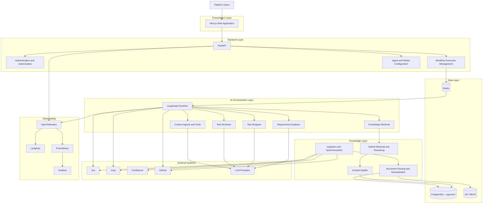
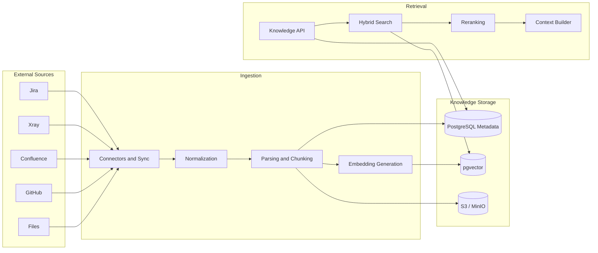
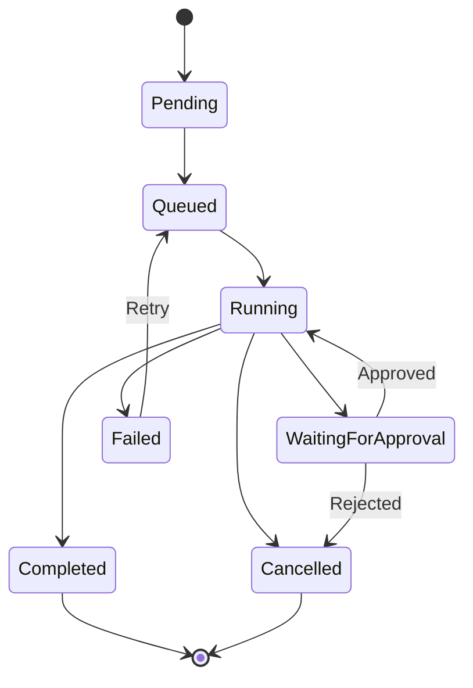
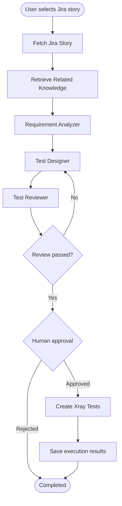

# QualiForge AI — Architecture Blueprint

**Document status:** Draft for architecture review  
**Version:** 0.1.0  
**Repository:** `qualiforge-ai`  
**Purpose:** Shared architecture baseline for ChatGPT, Gemini/Antigravity, Claude Opus, and human contributors.

---

## 1. Project Vision

QualiForge AI is an AI-powered Quality Engineering platform designed to help software development and testing teams improve software quality through intelligent, context-aware AI agents.

The platform connects software requirements, product documentation, test cases, source code, automation frameworks, and testing knowledge to support AI-driven testing workflows.

The goal is not simply to generate test cases using an LLM. The platform should provide an extensible environment where teams can configure, execute, monitor, evaluate, and improve AI agents and workflows throughout the software testing lifecycle.

### 1.1 Main objectives

- Transform software testing from predominantly manual execution into AI-assisted Quality Engineering.
- Connect knowledge from multiple enterprise systems.
- Generate and review test cases using contextual product and testing knowledge.
- Support multiple LLM providers and models.
- Orchestrate multi-agent workflows with human approval.
- Integrate with Jira, Xray, Confluence, GitHub, and CI/CD systems.
- Monitor agent executions, token usage, cost, latency, and quality.
- Provide traceability from requirements to generated tests and testing results.
- Allow teams to extend the platform with new agents, tools, integrations, and workflows.

### 1.2 Guiding principles

1. **Knowledge before generation:** Agents should use relevant and traceable project knowledge rather than rely only on their model's general knowledge.
2. **Human-in-the-loop:** Important testing decisions and external system changes should support human review and approval.
3. **Provider independence:** The architecture must not be tightly coupled to a single LLM provider.
4. **Observable by design:** Every workflow, agent, LLM call, and tool invocation should be traceable.
5. **Source of truth preservation:** Jira, Confluence, Xray, and GitHub remain authoritative for their respective data.
6. **Modular architecture:** New agents, workflows, providers, and connectors should be added without redesigning the platform.
7. **Security by design:** Permissions, data isolation, auditability, and sensitive-data handling are foundational requirements.

---

## 2. Target Users and Use Cases

### 2.1 Target users

| User | Main responsibilities |
|---|---|
| QA Engineer | Create, review, and maintain test cases |
| Automation Engineer | Generate and maintain automated tests |
| Developer | Improve unit testing and code quality |
| QA Lead / Test Manager | Manage testing workflows and quality metrics |
| Project Manager | Monitor testing progress and execution |
| Platform Administrator | Configure integrations, models, agents, and permissions |

### 2.2 Initial use cases

**UC-01: Jira User Story to Test Cases**

1. User selects a Jira user story.
2. Platform retrieves the requirement and related information.
3. Knowledge system retrieves relevant Confluence documentation, existing Xray tests, and testing guidelines.
4. Requirement Analysis Agent analyzes the story.
5. Test Design Agent generates test scenarios and test cases.
6. Test Review Agent checks completeness, relevance, consistency, and duplicates.
7. User reviews and approves the generated tests.
8. Platform creates the approved tests in Xray.
9. Execution history and cost are recorded.

**UC-02: Existing Test Case Analysis**

- Retrieve existing test cases from Xray.
- Analyze duplicates, missing coverage, and quality issues.
- Identify test cases that should be updated or removed.
- Provide recommendations for human approval.

**UC-03: Jira Test Case to Playwright Automation**

- Retrieve an existing manual test case.
- Evaluate automation feasibility.
- Analyze the target application and existing automation framework.
- Generate Playwright test code.
- Run validation and review.
- Create a pull request for human review.

**UC-04: Pull Request Unit Test Generation**

- Detect changed production code.
- Analyze code changes and existing unit tests.
- Generate additional unit tests.
- Run tests, linting, and coverage checks.
- Evaluate test quality.
- Publish the results or create a pull request.

**UC-05: Knowledge Discovery**

- Search across Jira, Confluence, Xray, and GitHub.
- Retrieve relevant requirements, specifications, test cases, and implementation references.
- Provide answers with source references and version information.

---

## 3. High-Level Architecture

### 3.1 Architecture overview

The platform follows a modular service-oriented architecture.

| Layer | Technology | Responsibility |
|---|---|---|
| Web application | Next.js + TypeScript | User interface and platform dashboard |
| Backend API | Python + FastAPI | Business APIs, authentication integration, execution management |
| Agent orchestration | Python + LangGraph | Multi-agent and workflow orchestration |
| Knowledge system | Python | Ingestion, parsing, indexing, retrieval, context construction |
| Relational database | PostgreSQL + pgvector | Platform data, knowledge metadata, vector search |
| Queue / cache | Redis | Background task dispatching and caching |
| Object storage | S3-compatible storage / MinIO | Documents, attachments, and snapshots |
| AI observability | Langfuse + OpenTelemetry | LLM and agent tracing |
| Infrastructure monitoring | Prometheus + Grafana | Service metrics and dashboards |
| External systems | Jira, Xray, Confluence, GitHub | Enterprise integrations |

### 3.2 Logical architecture



This diagram describes logical responsibilities, not mandatory deployment boundaries. Some components can initially run in the same process or container.

---

## 4. Technology Decisions

The following decisions represent the current proposed baseline. They are not all irreversible commitments.

| Area | Proposed technology | Status |
|---|---|---|
| Frontend | Next.js + TypeScript | Proposed |
| Backend API | FastAPI | Proposed |
| Agent orchestration | LangGraph Python | Proposed |
| Knowledge processing | Python | Proposed |
| Database | PostgreSQL | Proposed |
| Vector search | pgvector | Proposed for MVP |
| Queue | Redis | Proposed |
| Object storage | S3 / MinIO | Proposed |
| LLM observability | Langfuse | Proposed |
| Telemetry standard | OpenTelemetry | Proposed |
| Infrastructure monitoring | Prometheus + Grafana | Proposed |
| Containerization | Docker | Proposed |
| CI/CD | GitHub Actions | Proposed |

### 4.1 Frontend: Next.js

Responsibilities:

- Platform dashboard.
- Project and workspace management.
- Agent and workflow configuration.
- Workflow execution interface.
- Execution history and trace visualization.
- Human approval and review interfaces.
- Cost and quality reports.
- Integration configuration.

The frontend must not contain long-running AI execution logic.

Use Next.js as the presentation layer and optionally as a Backend-for-Frontend (BFF) where useful. FastAPI remains the primary backend business API.

### 4.2 Backend: FastAPI

Responsibilities:

- REST APIs.
- Authentication and authorization integration.
- Project and workspace management.
- Agent and workflow configuration.
- Workflow execution lifecycle.
- Integration management.
- Execution status and result APIs.
- Usage and cost aggregation APIs.
- Audit records.

FastAPI should enqueue long-running executions rather than execute the complete workflow inside an HTTP request.

Generate a TypeScript client from the FastAPI OpenAPI specification to maintain frontend/backend contract consistency.

### 4.3 Agent orchestration: LangGraph Python

LangGraph is the proposed orchestration framework.

Responsibilities:

- Workflow state management.
- Agent execution.
- Conditional routing.
- Tool invocation.
- Retry and error handling.
- Checkpointing.
- Human-in-the-loop approval.
- Streaming execution events.
- Multi-agent coordination.

Agents should be reusable components. Workflows should compose agents rather than duplicate their implementations.

Do not make every task an autonomous multi-agent workflow. Prefer deterministic code and direct API calls when they are sufficient.

### 4.4 LLM provider abstraction

The platform should support multiple providers.

Potential providers:

- OpenAI
- Anthropic
- Google Gemini
- DeepSeek
- Other compatible providers

Requirements:

- Centralized provider configuration.
- Model selection by workflow or agent.
- Secure API key management.
- Token usage collection.
- Cost calculation.
- Timeout and retry policies.
- Model fallback policies where appropriate.
- Provider-specific capabilities exposed through a normalized interface.

The platform must not assume that all providers return identical usage fields or support identical capabilities.

### 4.5 Observability

Proposed stack:

- Langfuse: LLM and agent traces, prompt versions, token usage, cost, latency, and evaluation.
- OpenTelemetry: distributed tracing and standardized telemetry.
- Prometheus: application and infrastructure metrics.
- Grafana: dashboards and alerts.

Every workflow execution should have a traceable relationship to its child agent executions, LLM calls, retrieval operations, and tool calls.

---

## 5. Knowledge System and RAG Architecture

### 5.1 Core principle

The Knowledge System is not simply a vector database.

It is a centralized knowledge access layer that synchronizes and indexes information from external systems while preserving the original systems as sources of truth.

### 5.2 Data sources

| Source | Information |
|---|---|
| Jira | Epics, stories, requirements, acceptance criteria, comments |
| Xray | Test cases, preconditions, test sets, test execution results |
| Confluence | Product specifications, architecture documents, testing guidelines |
| GitHub | Source code, pull requests, code documentation, unit tests |
| File storage | PDF, Word, Excel, Markdown and other documents |

### 5.3 Knowledge architecture



### 5.4 Storage strategy

Use PostgreSQL for:

- Canonical knowledge records.
- Source metadata.
- Document relationships.
- Version information.
- Permissions and access metadata.
- Chunk metadata.
- Embedding references.
- Synchronization state.

Use pgvector for:

- Embedding storage.
- Semantic similarity search.

Use S3 / MinIO for:

- Original documents.
- Attachments.
- Document snapshots.
- Large extracted artifacts.

### 5.5 Retrieval strategy

Implement hybrid retrieval:

1. Exact identifier lookup.
2. Keyword/full-text search.
3. Semantic vector search.
4. Metadata and permission filtering.
5. Reranking.
6. Context construction.

Important rule:

**Use direct APIs when the target record is already known. Use RAG when discovering relevant related knowledge.**

For example, when a user selects `PROJ-123`, retrieve that Jira issue directly through the Jira connector. Use RAG to discover related Confluence documentation, existing Xray tests, and testing guidelines.

### 5.6 Knowledge synchronization

Support:

- Initial full synchronization.
- Incremental synchronization.
- Webhook-driven updates when available.
- Scheduled reconciliation.
- Deletion and permission-change propagation.
- Version tracking.
- Sync failure monitoring.

Permission filtering must occur before retrieved content is exposed to an agent or user. Do not rely solely on filtering results in the frontend.

---

## 6. Agent Architecture

### 6.1 Agent design

An agent should have a defined contract:

- Unique identifier.
- Name and description.
- Input schema.
- Output schema.
- Instructions and prompt version.
- Tools and permissions.
- Model configuration.
- Timeout and retry policies.
- Evaluation criteria.
- Version.

### 6.2 Initial agent catalog

| Agent | Responsibility |
|---|---|
| Requirement Analyzer | Analyze requirements and acceptance criteria |
| Knowledge Retriever | Find relevant project knowledge |
| Test Designer | Generate test scenarios and test cases |
| Test Reviewer | Review completeness, correctness, and duplicates |
| Automation Feasibility Agent | Assess manual test automation feasibility |
| Playwright Generator | Generate Playwright automation code |
| Unit Test Generator | Generate unit tests from source code changes |
| Unit Test Reviewer | Review generated unit tests |

### 6.3 Agent execution lifecycle



The execution model must support:

- Asynchronous execution.
- Status updates.
- Progress events.
- Checkpoint persistence.
- Retry and recovery.
- Cancellation.
- Human approval.
- Execution history.

A human approval wait may last much longer than an ordinary worker task. The design must not depend on holding an HTTP request or a worker process open while waiting.

---

## 7. Workflow Architecture

A workflow is a versioned composition of agents, tools, conditions, and approval steps.

### 7.1 Example: Jira Story to Xray Tests



### 7.2 Workflow requirements

- Versioned workflow definitions.
- Configurable agents and model selection.
- Input and output schemas.
- Conditional routing.
- Retry policies.
- Human approval nodes.
- Execution cancellation.
- Execution history.
- Traceability.
- Cost and token aggregation.

### 7.3 Deterministic versus agentic execution

Prefer deterministic application logic for:

- Fetching Jira issues by ID.
- Creating Xray test cases.
- Validating schemas.
- Checking permissions.
- Persisting execution records.
- Enforcing approval policies.

Use LLM-based agents for:

- Requirement interpretation.
- Knowledge synthesis.
- Test design.
- Semantic review.
- Code analysis.

This separation improves predictability, security, and cost control.

---

## 8. AI Observability and Cost Management

### 8.1 Monitoring hierarchy

```text
Workflow Execution
  ├── Agent Execution
  │     ├── LLM Call
  │     ├── Tool Call
  │     └── Retrieval Operation
  └── Workflow Summary
```

### 8.2 Required telemetry

**Workflow level**

- Execution ID.
- Workflow name and version.
- User and project references.
- Start and end time.
- Duration.
- Status.
- Total tokens.
- Total estimated cost.
- Error and retry counts.

**Agent level**

- Agent name and version.
- Input/output references.
- Model used.
- Duration.
- Status.
- Retry count.
- LLM call count.

**LLM level**

- Provider and model.
- Prompt version.
- Input/output tokens.
- Cached and reasoning token usage when available.
- Latency.
- Estimated cost.
- Provider request ID.
- Error information.

**RAG level**

- Search query.
- Retrieved document identifiers.
- Source systems.
- Relevance scores.
- Reranking results.
- Retrieval latency.
- Context size.
- Document versions.

**Quality level**

- Requirement coverage.
- Test relevance.
- Duplicate test rate.
- Review acceptance rate.
- Human rejection rate.
- Citation accuracy.
- Retrieval evaluation metrics.

### 8.3 Data ownership

Langfuse should be used for detailed LLM and agent observability.

PostgreSQL should remain the platform's business database, containing workflow executions, agent configurations, project data, approvals, and summarized usage records.

Do not make Langfuse the only source of truth for business execution state.

### 8.4 Security

- Avoid storing secrets in prompts or traces.
- Mask sensitive content.
- Restrict access to prompts and model responses.
- Define trace retention policies.
- Separate tenant/project data.
- Audit sensitive access.
- Do not use high-cardinality identifiers as Prometheus metric labels.

---

## 9. Security and Governance

Security requirements must be included from the first implementation phase.

### 9.1 Authentication and authorization

- User authentication.
- Role-based access control.
- Project-level permissions.
- Agent and workflow permissions.
- Integration credentials management.
- Audit logging.

### 9.2 Integration security

- Secure storage of API credentials.
- OAuth where supported.
- Least-privilege integration scopes.
- Credential rotation.
- Webhook signature verification.
- External API rate limiting.

### 9.3 AI governance

- Human approval for external write operations.
- Prompt and workflow versioning.
- Traceability of AI-generated artifacts.
- Configurable model usage policies.
- Token and cost limits.
- Input and output validation.
- Protection against prompt injection from retrieved documents.

---

## 10. Deployment Architecture

### 10.1 Initial deployment

Use Docker Compose for local development and early MVP deployments.

Suggested services:

| Service | Container |
|---|---|
| Web | Next.js |
| API | FastAPI |
| Worker | Python + LangGraph |
| Database | PostgreSQL + pgvector |
| Queue | Redis |
| Object storage | MinIO |
| AI observability | Langfuse |
| Metrics | Prometheus |
| Dashboard | Grafana |

The API and worker may share Python application code while running as separate processes and containers.

### 10.2 Execution flow

1. User submits a workflow request from Next.js.
2. FastAPI validates permissions and request data.
3. FastAPI creates a workflow execution record.
4. Execution is dispatched to the background worker.
5. LangGraph runs the workflow.
6. State and checkpoint information are persisted.
7. Observability events are emitted.
8. Frontend receives progress updates through SSE or WebSocket.
9. Final results are stored and made available to the user.

### 10.3 Future deployment

The architecture should allow migration to cloud infrastructure and horizontal worker scaling without changing the business workflow contracts.

Do not introduce Kubernetes or other complex infrastructure until actual deployment and scaling requirements justify it.

---

## 11. Proposed Repository Structure

```text
qualiforge-ai/
├── apps/
│   ├── web/                       # Next.js frontend
│   ├── api/                       # FastAPI application
│   └── worker/                    # LangGraph worker entrypoint
│
├── services/
│   ├── orchestration/             # Workflow and agent runtime
│   ├── knowledge/                 # RAG and knowledge services
│   ├── integrations/              # External system connectors
│   └── observability/             # Telemetry and usage services
│
├── packages/
│   ├── contracts/                 # API schemas and contracts
│   ├── prompts/                   # Versioned prompt templates
│   ├── agent-definitions/         # Agent metadata and configuration
│   └── workflow-definitions/      # Workflow definitions
│
├── infrastructure/
│   ├── docker/
│   ├── postgres/
│   ├── monitoring/
│   └── scripts/
│
├── docs/
│   ├── architecture/
│   │   ├── ARCHITECTURE.md
│   │   ├── ARCHITECTURE_DECISIONS.md
│   │   └── diagrams/
│   ├── knowledge-system/
│   ├── agents/
│   ├── workflows/
│   ├── api/
│   └── development/
│
├── tests/
│   ├── integration/
│   └── e2e/
│
├── docker-compose.yml
├── .env.example
├── README.md
└── CONTRIBUTING.md
```

This structure is a proposal. The repository should avoid excessive package splitting before actual reuse requirements emerge.

---

## 12. Implementation Roadmap

### Phase 0 — Architecture and Foundation

- Confirm architecture and technology decisions.
- Define coding standards.
- Define API contracts.
- Define core database schema.
- Establish Docker Compose development environment.
- Establish CI pipeline.

**Deliverable:** A working development foundation.

### Phase 1 — Knowledge Foundation

- Implement Jira connector.
- Implement Confluence connector.
- Implement Xray connector.
- Define normalized knowledge model.
- Implement document parsing and chunking.
- Implement embeddings.
- Implement hybrid retrieval.
- Implement Context Builder.
- Add permission-aware retrieval.
- Create retrieval evaluation dataset.

**Deliverable:** A usable Knowledge API that can retrieve relevant information from multiple sources.

### Phase 2 — First AI Workflow

Implement Jira Story → Test Cases → Xray.

- Requirement Analyzer.
- Knowledge Retriever.
- Test Designer.
- Test Reviewer.
- Human approval.
- Xray integration.
- Workflow history and status.
- Langfuse tracing.
- Token and cost tracking.

**Deliverable:** A working end-to-end AI testing workflow.

### Phase 3 — Platform Capabilities

- Agent registry.
- Workflow registry and versioning.
- Model/provider management.
- Project and workspace management.
- Execution dashboard.
- Cost dashboard.
- Observability dashboard.
- Evaluation framework.
- User and role management.

**Deliverable:** A reusable AI Testing Platform.

### Phase 4 — Advanced Workflows

- Playwright test generation.
- Unit test generation.
- Test maintenance and optimization.
- PR review and test generation.
- Advanced RAG evaluation.
- Additional enterprise integrations.

**Deliverable:** Expanded AI-powered Quality Engineering capabilities.

---

## 13. Non-Goals for the Initial MVP

The initial MVP should NOT attempt to:

- Build a general-purpose autonomous AI platform.
- Implement a custom LLM.
- Build a vector database.
- Replace Jira, Xray, or Confluence.
- Build a custom observability engine.
- Implement a visual no-code workflow builder.
- Support every LLM provider immediately.
- Support every testing framework immediately.
- Introduce complex distributed infrastructure without a concrete need.

The initial objective is to prove that a reliable, traceable, and useful AI testing workflow can be delivered.

---

## 14. Architecture Decisions and Open Questions

The following topics require review before implementation decisions are finalized.

| ID | Topic | Current proposal | Status |
|---|---|---|---|
| ADR-001 | Frontend | Next.js + TypeScript | Proposed |
| ADR-002 | Backend API | FastAPI | Proposed |
| ADR-003 | Agent orchestration | LangGraph Python | Proposed |
| ADR-004 | Database | PostgreSQL + pgvector | Proposed |
| ADR-005 | Queue | Redis | Proposed |
| ADR-006 | Knowledge retrieval | Hybrid retrieval + reranking | Proposed |
| ADR-007 | AI observability | Langfuse + OpenTelemetry | Proposed |
| ADR-008 | Infrastructure monitoring | Prometheus + Grafana | Proposed |
| ADR-009 | Object storage | S3-compatible / MinIO | Proposed |
| ADR-010 | Deployment | Docker Compose initially | Proposed |

### Questions for architecture review

**A. Architecture and service boundaries**

1. Should the Knowledge System be a separate deployable service or initially a module within the FastAPI application?
2. Should workflow execution use Redis-based dispatching, or should we evaluate a durable workflow engine such as Temporal?
3. What should be the boundary between FastAPI business logic and LangGraph orchestration?
4. How should long-running workflow checkpoints and worker recovery be implemented?

**B. RAG and knowledge**

5. Is PostgreSQL + pgvector sufficient for the expected initial retrieval workload?
6. Should we introduce a dedicated search engine such as OpenSearch later?
7. How should we model relationships among Jira stories, Confluence pages, Xray tests, and GitHub code?
8. How should permission inheritance and document deletion be handled?
9. How should we evaluate retrieval quality before deploying agents?

**C. Agent architecture**

10. Should agents be implemented as Python modules, independently deployable services, or both depending on workload?
11. How should agent and workflow definitions be versioned?
12. How should we prevent unnecessary agent-to-agent delegation?
13. How should we enforce tool permissions and prevent unsafe external operations?

**D. LLM and observability**

14. Should Langfuse be the primary LLM observability platform?
15. What is the best strategy to normalize token usage and cost across providers?
16. Should MLflow be introduced for experiment tracking and evaluation?
17. How should we manage prompt versions, evaluation datasets, and model comparisons?
18. How should traces be correlated across API, worker, retrieval, and LLM calls?

**E. Platform and deployment**

19. What authentication and multi-tenancy model should be used?
20. Should the initial deployment target be a single VM, AWS, or a hybrid environment?
21. What are the expected concurrency, workflow duration, and data-volume targets?
22. What are the required backup, disaster recovery, and retention policies?

---

## 15. Architecture Review Protocol for AI Assistants

This document is the shared architecture baseline for all AI assistants working on QualiForge AI.

When reviewing this document, assistants should follow these rules:

1. Read the complete architecture document before making recommendations.
2. Do not silently change existing proposed architecture decisions.
3. Clearly distinguish confirmed decisions, proposals, assumptions, and open questions.
4. Challenge decisions when there are concrete technical or operational reasons.
5. Compare alternatives using maintainability, scalability, complexity, security, cost, and developer experience.
6. Avoid introducing technologies without explaining the problem they solve.
7. Prefer the simplest architecture that satisfies the current requirements.
8. Consider compatibility with the existing repository and implementation constraints.
9. Identify risks, trade-offs, migration costs, and operational consequences.
10. Provide references to official documentation for important technical claims.
11. Do not modify architecture documents or implementation code during a review unless explicitly requested.
12. Do not assume an architectural proposal is approved merely because it appears in this document.

### Required review output

Each AI assistant should produce:

1. Overall assessment.
2. Architecture strengths.
3. Architecture weaknesses and risks.
4. Recommended changes, with rationale.
5. Alternative technologies and trade-offs.
6. Answers to the open architecture questions.
7. Proposed ADR changes.
8. A prioritized list of decisions required before implementation.

### Review philosophy

The objective is not to make every AI assistant agree.

The objective is to discover incorrect assumptions, hidden complexity, missing requirements, and better technical alternatives before implementation.

All architecture changes must be explicitly discussed and recorded in `ARCHITECTURE_DECISIONS.md`.

---

## 16. Definition of Architecture Readiness

The architecture is ready for MVP implementation when:

- Core technology decisions have been reviewed.
- Service responsibilities are clear.
- Database entities and relationships are defined.
- Workflow execution lifecycle is defined.
- Knowledge synchronization and retrieval strategy are defined.
- Authentication and permission model are defined.
- LLM provider abstraction is defined.
- Observability and cost tracking are defined.
- Deployment and local development environments are documented.
- MVP acceptance criteria are agreed upon.

**End of document.**