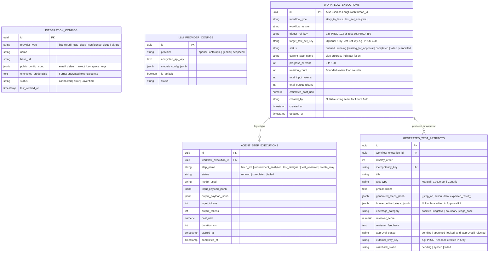
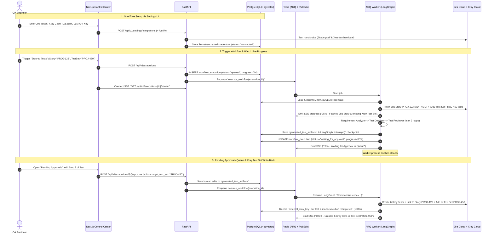
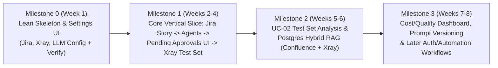

# QualiForge AI — Independent Architecture Review

**Reviewer:** Gemini (Senior Software Architect Review)  
**Date:** 2026-11-10 (Updated with Project Owner Constraints)  
**Target Document:** `docs/architecture/ARCHITECTURE.md` (v0.1.0)

### Validated Project Context & Constraints

This review evaluates `ARCHITECTURE.md` against the actual constraints confirmed by the project owner:

1. **Solo Builder Profile:** Built and maintained by **a single developer (SDET / QA Engineer)**. Every architectural decision must optimize for **solo-developer velocity, debuggability, and near-zero operational overhead**.
2. **Core Product Experience:** A **centralized QA Workflow Control Center** where QA engineers can:
   - Configure external systems (Jira, Xray, Confluence, GitHub, LLM providers) via a **Settings / Configuration UI** (storing API keys/credentials and testing connections).
   - Trigger AI workflows on demand.
   - Monitor **real-time workflow progress** step-by-step.
   - Manage a **Pending Approvals Queue** to review, inline-edit, and approve generated test cases before writing back to Xray.
3. **Target Atlassian / Xray Model:** **Atlassian Cloud (Jira Cloud + Xray Cloud + Confluence Cloud)** where tests are organized using **Xray Test Sets** (rather than Xray Test Repository folder trees).
4. **Authentication & Authorization Scope:** **No SSO and no complex AuthN/AuthZ for MVP.** Authentication and RBAC will be added in a later phase; MVP runs as a trusted internal QA portal.

---

## 1. Executive Assessment

### 1.1 Verdict: **Strong Product Vision, But Architecturally Over-Engineered for a Solo SDET Builder**

The vision in `docs/architecture/ARCHITECTURE.md`—a centralized AI Quality Engineering control center with human-in-the-loop approval, source-of-truth preservation in Jira/Xray/Confluence, and deterministic external writes—is spot-on for QA teams.

However, **for a solo SDET building the MVP, the proposed architecture in `ARCHITECTURE.md` carries severe over-engineering risks** that will stall delivery if not aggressively simplified:

1. **Enterprise Governance & Auth Prematurely Front-Loaded:** Sections 5.6, 9.1, and Phase 1 mandate authentication, RBAC, project-level permissions, and permission-aware RAG filtering from the first implementation phase. Since you have explicitly deferred AuthN/AuthZ and SSO, building permission inheritance from Jira/Confluence into `pgvector` right now is 100% wasted effort.
2. **Horizontal Roadmap Trap (Biggest Delivery Risk):** Section 12 (Roadmap) puts the entire Knowledge Foundation (Phase 1: Jira, Confluence, Xray ingestion, chunking, embeddings, hybrid search, reranking, permission filtering, eval dataset) _before_ building the first workflow (Phase 2), and pushes **Integration & Model Configuration UI** to Phase 3. For your product, **the Settings/Configuration UI, Workflow Trigger UI, Live Progress View, and Pending Approvals Queue ARE the MVP**—they must be built in the very first vertical slice!
3. **Container & Package Sprawl:**
   - Section 10.1 proposes 9 logical services in Docker Compose, including self-hosted **Langfuse** (which in Langfuse v3 requires **ClickHouse, Redis, Postgres, MinIO/S3, `langfuse-web`, and `langfuse-worker`** — [Langfuse Self-Hosting Architecture](https://langfuse.com/self-hosting/architecture)), plus **Prometheus** and **Grafana**. Running 12–14 containers locally will consume 8–12 GB RAM and drain solo-developer time on DevOps maintenance.
   - Section 11 splits the repository into 10+ top-level `apps/`, `services/`, and `packages/` directories, which creates unnecessary Python packaging friction for a single developer.
4. **Missing Concrete Contracts for Core QA Workflows:**
   - How **UI-configured API keys and credentials** (Jira, Xray, Confluence, LLM providers) are encrypted in PostgreSQL and dynamically loaded at runtime by connectors and LangGraph nodes.
   - How **Xray Cloud Test Sets** are queried and populated via **Xray Cloud's GraphQL/REST v2 API** alongside **Jira Cloud's REST v3 (ADF) API**.
   - How **LangGraph `interrupt()` and `Command(resume=...)`** power the **Pending Approvals Queue** without holding worker processes open, and how QA engineers can **inline-edit generated test steps** before Xray write-back.

### 1.2 Key Architecture Strengths to Preserve

- **Deterministic vs. Agentic Separation (Section 7.3):** Fetching Jira stories, querying Xray Test Sets, validating schemas, and creating Xray test cases in deterministic Python while reserving LLMs for requirement analysis, test design, and semantic review keeps workflows predictable and debuggable.
- **Direct API Lookup vs. RAG Discovery Rule (Section 5.5):** Fetching the target Jira story (`PROJ-123`) and its explicitly linked Xray Test Set directly via API while using RAG only for related Confluence specs and unlinked test deduplication avoids stale cache bugs.
- **PostgreSQL as Authoritative Business Store (Section 8.3):** Storing workflow executions, pending approvals, integration configs, and cost summaries in PostgreSQL rather than relying on Langfuse for application state enables fast UI queries for your Pending Approvals dashboard.
- **Non-Blocking Human Approval Requirement (Section 6.3):** Designing `WaitingForApproval` as a persisted checkpoint state rather than a blocked thread is essential for a QA portal where approvals may sit in a queue for hours or days.

---

## 2. Architecture Concerns

Below are the critical weaknesses, risks, and missing components across the 10 focus areas, calibrated to your solo-builder and QA-portal requirements.

### 2.1 Overall Architecture & Service Boundaries: Too Many Moving Parts for One Developer

- **Multi-Package Split (Section 11):** Splitting Python code into `apps/api`, `apps/worker`, `services/orchestration`, `services/knowledge`, `services/integrations`, `services/observability`, and four `packages/*` folders forces a solo developer to maintain multiple `pyproject.toml` files and cross-package imports.
- **Recommendation:** Consolidate all Python code into **one unified modular monolith package (`backend/src/qualiforge/`)**. Run the exact same codebase for both the FastAPI server and the background worker (or even run the background worker inside FastAPI's async event loop during early local dev if desired, using `ARQ` + Redis for clean background queueing).

### 2.2 Next.js, FastAPI, and LangGraph Integration: Missing UX-to-Backend Wiring

- **Live Progress Streaming Across Worker & API:** Your core UX requires QA engineers to view live workflow progress (`Fetching Jira Story` -> `Analyzing Requirements` -> `Designing Tests` -> `Reviewing Tests` -> `Pending Approval`). Because LangGraph runs in a background task while the browser connects to FastAPI, the worker must publish step events to **Redis Pub/Sub (or Redis Streams)** and also persist current step status in PostgreSQL so that:
  1. An open browser tab receives instant **Server-Sent Events (SSE)** updates, and
  2. A QA engineer who refreshes the page or opens the dashboard mid-run immediately sees the current active step from PostgreSQL before subscribing to the SSE stream.
- **Next.js BFF Ambiguity (Section 4.1):** Since there is no SSO/auth complexity in MVP, Next.js does not even need a complex BFF layer. Keep 100% of API endpoints in FastAPI and generate a typed TypeScript client for Next.js.

### 2.3 RAG & Enterprise Knowledge Architecture: Xray Test Sets & Jira Cloud ADF Specifics

- **Xray Cloud Dual-API & Test Set Model:** In Atlassian Cloud, an **Xray Test Set** is a Jira Issue shell (e.g., `PROJ-450`), but the list of `Test` issues inside that Test Set and the actual **Test Steps (`action`, `data`, `result`)** and **Preconditions** of each test are stored inside Xray Cloud's own database.
  - Reading a Test Set and its tests' steps requires authenticating with an Xray Client ID + Secret (`POST https://xray.cloud.getxray.app/api/v2/authenticate`) and querying Xray's **GraphQL API** (`getTestSet` / `getTests`) ([Xray Cloud GraphQL API](https://docs.getxray.app/display/XRAYCLOUD/GraphQL+API)).
  - Creating approved tests and associating them with an **Xray Test Set** requires either Xray Cloud's **Bulk Test Import API (`POST /api/v2/import/test/bulk`)** (passing the Test Set issue key in the `fields` / `xray_test_sets` link) or creating the test and calling the `addTestsToTestSet` GraphQL mutation.
- **Jira Cloud v3 ADF & Confluence XHTML Parsing:** Jira Cloud REST API v3 returns descriptions and acceptance criteria in **Atlassian Document Format (ADF JSON)** ([Atlassian ADF Spec](https://developer.atlassian.com/cloud/jira/platform/apis/document/structure/)). Feeding raw ADF JSON to an LLM wastes 3x–5x tokens and degrades reasoning; a clean deterministic `adf_to_markdown()` converter is needed on day one.
- **Over-Scoped RAG Permission Filtering (Section 5.6):** `ARCHITECTURE.md` insists on document-level permission filtering in RAG. Since there is no AuthN/AuthZ in MVP and integrations use centrally configured API credentials from the Settings UI, RAG queries only need simple metadata filtering (`WHERE project_key = :project_key AND is_deleted = FALSE`).

### 2.4 Agent Orchestration & Workflow Execution: Pending Approvals Queue & Inline Editing

- **Binary Approval Gate Is Too Rigid for QA Engineers (Section 6.3 & 7.1):** In `ARCHITECTURE.md`, human approval is modeled as a simple `Approved` / `Rejected` transition. In practice, when a QA engineer opens the **Pending Approvals Queue** and inspects 8 generated test cases for a Jira story:
  - They need to **edit a test step's action, test data, or expected result inline** in the UI.
  - They need to **check/uncheck individual test cases** (e.g., approve 6 out of 8 and discard 2 redundant ones).
  - They need to select or confirm the **target Xray Test Set (`PROJ-450`)** where approved tests will be added.
  - They may want to click **"Regenerate with Feedback"** (e.g., _"Also include boundary tests for negative quantities"_).
- **Unbounded Review Loops (Section 7.1):** The `DECISION -->|No| DESIGN` edge between `Test Reviewer` and `Test Designer` lacks a maximum iteration counter. Without `max_revision_iterations = 2`, two disagreeing prompts will loop indefinitely and exhaust LLM credits.
- **Idempotency on Xray Write-Backs:** When writing 6 approved tests to Jira/Xray and linking them to an Xray Test Set, if test #4 fails due to a transient Jira timeout, retrying the workflow must not duplicate tests #1–#3.

### 2.5 Database & Data Modeling: Missing Settings/Credentials & Approval Queue Tables

- `ARCHITECTURE.md` has no database schema definitions, and notably lacks tables for the **UI-driven Integration & LLM Configuration pages** you require:
  - Where are Jira URLs, Jira API tokens, Xray Client ID/Secret, Confluence tokens, and OpenAI/Anthropic/Gemini API keys stored when configured via the UI?
  - They must be stored in PostgreSQL with **application-level symmetric encryption (Fernet AES-128-CBC + HMAC-SHA256 via `cryptography`)** using a single master `ENCRYPTION_KEY` in `.env`, never returned in plaintext to the frontend after saving (masked as `••••••••abcd`), and tested via a `POST /api/v1/integrations/{type}/test-connection` endpoint.

### 2.6 LLM Provider Abstraction: Must Support UI-Configured API Keys

- Most default LLM wrapper tutorials assume `OPENAI_API_KEY` or `ANTHROPIC_API_KEY` live exclusively in OS environment variables.
- Because QualiForge AI lets users configure credentials via a Configuration UI page, the `ModelGateway` factory must **dynamically resolve the active provider's decrypted API key, base URL, and default model from PostgreSQL (cached in memory/Redis with cache invalidation on Settings update)** at workflow execution time, falling back to `.env` variables only if no DB config exists.

### 2.7 AI Observability, Tracing, Token Usage & Cost Management

- **Langfuse v3 Self-Hosting Bloat:** Self-hosting Langfuse v3 adds 6 containers (including ClickHouse and MinIO). For a solo developer, **PostgreSQL should capture first-class step traces, prompts/outputs, token usage, and USD cost directly in `workflow_executions` and `agent_step_executions`** so the Next.js UI can render execution details, progress, and cost natively out of the box—while making Langfuse an **optional** plug-in telemetry sink (via Langfuse Cloud free tier or an optional Docker Compose profile).

### 2.8 Security, Multi-Tenancy & Permissions

- **Auth Deferred — Keep an Auth-Ready Seam:** Since authentication/authorization will be developed later, do **not** pollute MVP endpoints with complex OAuth/JWT middleware. However, use a single FastAPI dependency `get_current_actor() -> ActorContext` that currently returns a default system/QA actor (`id="default-qa-user"`), and include nullable `created_by` / `approved_by` string fields on `workflow_executions` and `approval_decisions`. When you add auth later, you only swap out `get_current_actor()` without rewriting a single route or database table.
- **Credential Encryption at Rest:** Because external API keys (Jira, Xray, Confluence, LLMs) are entered via the web UI and stored in PostgreSQL, encrypting secret columns at rest with `cryptography.fernet.Fernet` is the #1 security requirement for MVP.

### 2.9 Deployment, Scalability & Operational Complexity

- A solo developer should not run MinIO, Prometheus, Grafana, and a 6-container Langfuse v3 stack just to develop and run the platform. A **5-container stack (`postgres`, `redis`, `api`, `worker`, `web`)** covers 100% of MVP functional requirements.

### 2.10 MVP Scope & Implementation Roadmap

- The roadmap in Section 12 of `ARCHITECTURE.md` is inverted for your goals:
  - It puts **Integration/Model Configuration UI**, **Execution Dashboard**, and **Pending Approvals UI** in Phase 2–3, _after_ building a full multi-source RAG engine in Phase 1.
  - Instead, **Milestone 1** must deliver the **Configuration UI (Jira/Xray/LLM credentials) + Workflow Trigger + Live Progress + Pending Approvals Queue + Xray Test Set Write-Back**, using direct Jira/Xray API calls first. Then **Milestone 2** adds Confluence & Xray Test Set RAG indexing.

---

## 3. Technology Evaluation

| Area                                             | Proposed in `ARCHITECTURE.md` | Evaluation & Recommendation for Solo SDET Builder                                                                                                                                                                                                                                                                                                                     |
| ------------------------------------------------ | ----------------------------- | --------------------------------------------------------------------------------------------------------------------------------------------------------------------------------------------------------------------------------------------------------------------------------------------------------------------------------------------------------------------- |
| **Frontend (ADR-001)**                           | Next.js + TypeScript          | **Keep.** Use Next.js (App Router) + Tailwind + `shadcn/ui` + TanStack Query. Generate TypeScript API clients automatically from FastAPI's `openapi.json` via `@hey-api/openapi-ts` so you never hand-write frontend/backend DTO types.                                                                                                                               |
| **Backend API (ADR-002)**                        | FastAPI                       | **Keep.** Use Python 3.12+, FastAPI, Pydantic v2, SQLAlchemy 2.0 (`asyncpg`), and Alembic inside a single unified `backend/` project managed by `uv`.                                                                                                                                                                                                                 |
| **Agent Orchestration (ADR-003)**                | LangGraph Python              | **Keep.** Use `StateGraph` with `langgraph-checkpoint-postgres` (`AsyncPostgresSaver`). Use `interrupt()` at the Human Approval node so the worker exits cleanly while the workflow sits in the **Pending Approvals Queue**, and `Command(resume=...)` when the user submits edits/approval from the UI.                                                              |
| **Task Queue & Progress Streaming (ADR-005)**    | Redis (unspecified library)   | **Keep Redis, specify `ARQ` + Redis Pub/Sub.** `ARQ` is a lightweight, `asyncio`-native Python job queue built for FastAPI/Pydantic. Pair it with Redis Pub/Sub to push live step progress events to FastAPI's SSE endpoint (`GET /api/v1/executions/{id}/stream`).                                                                                                   |
| **Database & Vector Search (ADR-004 & ADR-006)** | PostgreSQL + `pgvector`       | **Keep.** PostgreSQL 16 + `pgvector >= 0.8.0` (`halfvec` HNSW index with `hnsw.iterative_scan = 'relaxed_order'`) + PostgreSQL native Full-Text Search (`tsvector` + `GIN` index) handles relational state, LangGraph checkpoints, encrypted integration settings, and hybrid RAG in a **single database**.                                                           |
| **LLM Provider Abstraction**                     | Custom multi-provider layer   | **Use LangChain `init_chat_model` + LiteLLM Pricing Map inside a thin `ModelGateway` class.** Dynamically instantiate the chat model using the decrypted API key and model name stored in PostgreSQL Settings, and enforce `.with_structured_output(PydanticSchema)` for all agent outputs.                                                                           |
| **Object Storage (ADR-009)**                     | S3 / MinIO                    | **Defer MinIO container for MVP.** Normalized Jira stories, Confluence pages, and Xray Test Sets are text/JSON and fit easily in PostgreSQL `TEXT`/`JSONB` columns. If file uploads (PDF/Word/Excel) are needed later, store them on a mounted Docker volume (`/data/storage`) behind a 30-line `StorageService` interface, switching to S3 only in cloud deployment. |
| **AI Observability (ADR-007)**                   | Langfuse + OpenTelemetry      | **Make Langfuse Optional (`--profile observability` or Langfuse Cloud).** Store core execution steps, rendered prompts, structured outputs, token counts, and costs directly in PostgreSQL (`agent_step_executions`) so your Next.js UI shows full execution traces natively even when Langfuse is turned off.                                                        |
| **Infra Monitoring (ADR-008)**                   | Prometheus + Grafana          | **Defer until post-MVP production.** Completely unnecessary for a solo developer when Next.js + PostgreSQL already display workflow statuses, latencies, error rates, and token costs.                                                                                                                                                                                |

### Conditions That Would Change These Recommendations

- **Queue / Orchestration:** Only evaluate **Temporal** if you later orchestrate multi-hour CI/CD test execution pipelines across dozens of runner machines.
- **Vector Database:** Only evaluate **Qdrant / OpenSearch** if your indexed knowledge base grows beyond **5 million chunks**.
- **Object Storage:** Only introduce **S3 / MinIO** when you begin storing binary attachments, screenshots, or Playwright trace zip archives (Phase 4).

---

## 4. Missing Design Decisions (Must Be Locked In Before Coding)

### 4.1 Dynamic Integration & LLM Configuration Architecture (Settings UI)

Because you want QA engineers to configure Jira, Xray, Confluence, GitHub, and LLM credentials via configuration pages rather than hardcoding `.env` files:

1. **Master Encryption Key:** Only one secret is required in `.env`: `QUALIFORGE_MASTER_KEY` (a 32-byte url-safe base64 key for `cryptography.fernet.Fernet`).
2. **`integration_configs` Table:**
   - Stores `id`, `provider_type` (`jira_cloud`, `xray_cloud`, `confluence_cloud`, `github`), `name`, `base_url`, `public_config_jsonb` (e.g., email, default Jira project keys, default Xray Test Set keys, Confluence space keys), `encrypted_credentials` (Fernet-encrypted JSON containing API tokens / Xray `client_id` & `client_secret`), `status` (`connected`, `unverified`, `error`), `last_verified_at`.
3. **`llm_provider_configs` Table:**
   - Stores `id`, `provider` (`openai`, `anthropic`, `gemini`, `deepseek`, `openai_compatible`), `base_url`, `encrypted_api_key`, `enabled_models_jsonb`, `is_default`, `status`, `last_verified_at`.
4. **"Test Connection" API Endpoints:**
   - `POST /api/v1/settings/integrations/{id}/verify` actually performs a lightweight handshake (e.g., `GET /rest/api/3/myself` for Jira Cloud; `POST /api/v2/authenticate` for Xray Cloud; a 1-token ping for LLM providers) and updates `status = 'connected'`.
5. **Security Rule:** `GET /api/v1/settings/...` **never** returns raw API keys to the browser—only a masked preview (e.g., `sk-...9f3a`) and `has_secret: true`.

### 4.2 Xray Cloud Test Set Data Model & Dual-API Workflow

Since your Xray tests are organized around **Xray Test Sets**:

1. **Reading Existing Tests (for Context & Deduplication in UC-01 and Analysis in UC-02):**
   - Given a Jira Story (`PROJ-123`) or an explicit Xray Test Set key (`PROJ-450`), the connector queries **Xray Cloud GraphQL API** (`getTestSet(issueId: ...)` or `getTests(jql: "issue in testSetTests('PROJ-450')")`) to retrieve each test's Jira key, Summary, Test Type (`Manual` / `Generic` / `Cucumber`), Preconditions, and ordered **Steps (`action`, `data`, `result`)**.
2. **Writing Approved Tests Back to Xray & Linking to a Test Set:**
   - In the **Pending Approvals UI**, the QA engineer can optionally specify an **existing Xray Test Set key (e.g., `PROJ-450`)** or request creation of a **new Xray Test Set** for the Jira Story.
   - Upon approval, the deterministic `CREATE_XRAY_TESTS` node:
     1. Creates each approved `Test` issue (with its steps) via Xray Cloud's API (recording `external_xray_issue_key` on each `generated_test_artifact` row for idempotency),
     2. Links each created `Test` to the source Jira Story (`PROJ-123`) via standard Jira issue link (`Tests`), and
     3. Associates the created `Test` issues with the target **Xray Test Set (`PROJ-450`)** via Xray Cloud GraphQL `addTestsToTestSet(issueId: $testSetId, testIssueIds: [...])`.

### 4.3 Centralized Workflow & Pending Approvals Database Schema

Separate LangGraph's internal checkpoint tables from clean business tables designed to power your **QA Workflow Control Center UI**:



### 4.4 Human-in-the-Loop Contract for the Pending Approvals UI

When a workflow reaches `HUMAN_APPROVAL`, the worker updates `workflow_executions.status = 'waiting_for_approval'`, writes the proposed tests into `generated_test_artifacts`, calls LangGraph `interrupt()`, and exits the worker task.
The **Pending Approvals UI** queries `GET /api/v1/executions?status=waiting_for_approval` and allows the QA engineer to submit:

- **Action 1 — Approve & Push to Xray (`POST /api/v1/executions/{id}/approve`):** Accepts the list of selected artifact IDs, any inline edits to `title`, `preconditions`, or `steps_jsonb`, and the `target_test_set_key`. Updates PostgreSQL and enqueues an ARQ job to resume the LangGraph `thread_id` at `CREATE_XRAY_TESTS`.
- **Action 2 — Request Regeneration with QA Feedback (`POST /api/v1/executions/{id}/request-changes`):** Accepts natural-language feedback from the QA engineer (e.g., _"Add negative test cases for invalid coupon codes"_), resumes the LangGraph `thread_id`, and routes back to `TEST_DESIGNER` with the human feedback injected into the prompt.
- **Action 3 — Reject / Cancel (`POST /api/v1/executions/{id}/reject`):** Marks the execution `cancelled` and closes the thread.

---

## 5. Recommended Architecture Changes

### 5.1 Simplified Solo-Developer Repository Structure

Collapse the 10-folder multi-package structure in Section 11 of `ARCHITECTURE.md` into a single, cohesive repository with **one Next.js app** and **one Python package (`backend/src/qualiforge`)**:

```text
qualiforge-ai/
├── apps/
│   └── web/                                # Next.js (App Router, TypeScript, Tailwind, shadcn/ui)
│       ├── src/app/
│       │   ├── page.tsx                    # Dashboard (Active runs, Pending Approvals count, Cost summary)
│       │   ├── workflows/                  # Trigger Workflow & Live Execution Progress view
│       │   ├── approvals/                  # Pending Approvals Queue & Inline Test Step Editor
│       │   ├── knowledge/                  # Sync status & Search across Jira / Xray Test Sets / Confluence
│       │   └── settings/                   # Configuration UI (Jira, Xray, Confluence, GitHub, LLM API keys)
│       └── src/lib/api-client/             # Auto-generated TypeScript client from FastAPI OpenAPI
│
├── backend/
│   ├── pyproject.toml                      # Single uv project for API + Worker
│   ├── alembic/                            # PostgreSQL + pgvector migrations
│   ├── src/qualiforge/
│   │   ├── main.py                         # FastAPI application entrypoint
│   │   ├── worker.py                       # ARQ background worker entrypoint
│   │   ├── core/                           # Config, Fernet credential encryption, auth-ready actor stub
│   │   ├── db/                             # SQLAlchemy 2.0 async models & session
│   │   ├── api/                            # FastAPI routers (settings, workflows, approvals, sse, knowledge)
│   │   ├── integrations/                   # Jira Cloud v3 (ADF), Xray Cloud (GraphQL + Test Sets), Confluence
│   │   ├── llm/                            # Dynamic ModelGateway (loads keys from DB), token/cost tracker
│   │   ├── knowledge/                      # Markdown normalizer, chunker, pgvector + tsvector hybrid RRF
│   │   └── workflows/                      # LangGraph graphs (story_to_tests, test_set_analyzer) & agents
│   └── tests/
│
├── docker-compose.yml                      # Lean 5-container setup (postgres, redis, api, worker, web)
└── .env.example                            # Only needs QUALIFORGE_MASTER_KEY, DATABASE_URL, REDIS_URL
```

### 5.2 Concrete End-to-End Execution & Approval Flow



### 5.3 Lean 5-Container Default `docker-compose.yml`

Strip out MinIO, Prometheus, Grafana, and the 6-container self-hosted Langfuse v3 stack from the default `docker-compose.yml`.

- **Default (`docker compose up`):**
  1. `postgres` (`pgvector/pgvector:pg16`) — stores business tables, encrypted settings, LangGraph checkpoints, and `pgvector` embeddings.
  2. `redis` (`redis:7-alpine`) — powers `ARQ` job queue and SSE live progress Pub/Sub.
  3. `api` (FastAPI) — REST API + SSE streaming.
  4. `worker` (Python ARQ + LangGraph) — executes workflows and knowledge sync jobs.
  5. `web` (Next.js) — QA Control Center UI.
- _(Optional)_ If you want deep LLM prompt trace UI in addition to the built-in Next.js execution step viewer, either configure a free **Langfuse Cloud** API key inside the QualiForge Settings UI, or start self-hosted Langfuse via `docker compose --profile observability up`.

### 5.4 Proposed ADR Updates (Updating Section 14 of `ARCHITECTURE.md`)

| ID                  | Topic                               | Original Proposal            | Recommended Update for Solo Builder MVP                                                                                                                                                                                                |
| ------------------- | ----------------------------------- | ---------------------------- | -------------------------------------------------------------------------------------------------------------------------------------------------------------------------------------------------------------------------------------- |
| **ADR-001**         | Frontend                            | Next.js + TypeScript         | **Confirm:** Next.js App Router + auto-generated OpenAPI TS client (`@hey-api/openapi-ts`).                                                                                                                                            |
| **ADR-002**         | Backend API                         | FastAPI                      | **Confirm:** FastAPI + SQLAlchemy 2.0 (`asyncpg`) + Pydantic v2 in a single unified `backend/` package.                                                                                                                                |
| **ADR-003**         | Agent Orchestration                 | LangGraph Python             | **Confirm & Specify:** LangGraph `StateGraph` + `AsyncPostgresSaver` (`interrupt()` / `Command(resume=...)`) with `max_revision_iterations = 2`.                                                                                       |
| **ADR-004**         | Database                            | PostgreSQL + pgvector        | **Confirm & Specify:** PostgreSQL 16 + `pgvector >= 0.8.0` (`halfvec` HNSW + native `tsvector` FTS) as the single stateful store for MVP.                                                                                              |
| **ADR-005**         | Queue & Streaming                   | Redis                        | **Confirm & Specify:** Redis 7 with **`ARQ`** for background jobs and **Redis Pub/Sub** for real-time SSE workflow progress.                                                                                                           |
| **ADR-006**         | Knowledge Retrieval                 | Hybrid retrieval + reranking | **Simplify for MVP:** Direct API fetch for target Jira Story & target Xray Test Set; Postgres Hybrid RRF (`pgvector` + `tsvector`) for related Confluence pages and other Xray Test Sets; **no per-user ACL filtering needed in MVP**. |
| **ADR-007**         | AI Observability                    | Langfuse + OpenTelemetry     | **Refine:** Persist step-level inputs, outputs, tokens, and costs directly in PostgreSQL (`agent_step_executions`) for the built-in UI; make Langfuse an optional telemetry integration configurable in Settings.                      |
| **ADR-008**         | Infra Monitoring                    | Prometheus + Grafana         | **Defer until post-MVP.**                                                                                                                                                                                                              |
| **ADR-009**         | Object Storage                      | S3 / MinIO                   | **Defer MinIO container for MVP.** Store normalized Markdown/JSON in PostgreSQL; use local Docker volume behind a `StorageService` interface if file uploads are added.                                                                |
| **ADR-010**         | Deployment                          | Docker Compose               | **Confirm:** Lean 5-container `docker-compose.yml` (`postgres`, `redis`, `api`, `worker`, `web`).                                                                                                                                      |
| **ADR-011** _(New)_ | Integration & Credential Management | _(Missing)_                  | **Add:** UI-driven Settings pages backed by Fernet-encrypted PostgreSQL tables (`integration_configs`, `llm_provider_configs`) and live `/verify` connection-test endpoints.                                                           |
| **ADR-012** _(New)_ | Authentication & Authorization      | Full RBAC in Phase 1         | **Defer AuthN/AuthZ & SSO to Post-MVP:** Use a stub `get_current_actor()` dependency in FastAPI and nullable actor columns so auth can be dropped in later with zero schema rework.                                                    |

---

## 6. MVP Implementation Plan (Solo-Developer Vertical Slices)

The roadmap in Section 12 of `ARCHITECTURE.md` should be re-ordered so you have a **usable QA Workflow Control Center with Settings, Live Progress, and Pending Approvals** as early as possible.



### Milestone 0: Foundation & Integration Settings UI (Week 1)

- Create unified repo (`apps/web`, `backend/src/qualiforge`) and the 5-container `docker-compose.yml`.
- Create Alembic migration for `integration_configs`, `llm_provider_configs`, `workflow_executions`, `agent_step_executions`, and `generated_test_artifacts`.
- Implement Fernet credential encryption service and dynamic `ModelGateway`.
- **Build the Settings / Configuration UI in Next.js:**
  - Configure & test **Jira Cloud** connection (Base URL, Email, API Token -> `GET /rest/api/3/myself`).
  - Configure & test **Xray Cloud** connection (Client ID, Client Secret -> `POST /api/v2/authenticate`).
  - Configure & test **Confluence Cloud** connection.
  - Configure & test **LLM Provider** (OpenAI / Anthropic / Gemini / DeepSeek API Key + default model selection).
- **Deliverable:** You can open the web UI, configure your API keys, click "Test Connection," and verify green status across all providers.

### Milestone 1: End-to-End UC-01 (`Jira Story -> Pending Approvals Queue -> Xray Test Set`) (Weeks 2–4)

- **Connectors:** Implement `JiraCloudClient` (fetch Story + Epic + ADF-to-Markdown converter) and `XrayCloudClient` (fetch existing tests in an Xray Test Set via GraphQL; create new tests and link them to the Story + target Xray Test Set via GraphQL/REST v2).
- **LangGraph Workflow (`story_to_tests`):**
  1. `fetch_context_node` (fetches Jira Story + target Xray Test Set tests directly).
  2. `requirement_analyzer_node` (extracts testable requirements, edge cases, ambiguities).
  3. `test_designer_node` (generates structured test cases with `title`, `preconditions`, `steps: [{action, data, expected_result}]`).
  4. `test_reviewer_node` (checks coverage, flags duplicates against the Xray Test Set, loops back to designer max 2 times if needed).
  5. `human_approval_node` (persists artifacts to `generated_test_artifacts` and calls `interrupt()`).
  6. `xray_writeback_node` (idempotently creates approved/edited tests in Xray Cloud and adds them to the Xray Test Set).
- **QA Control Center UI (Next.js):**
  - **Trigger Workflow Dialog:** Enter Jira Story Key (`PROJ-123`) and optional target Xray Test Set Key (`PROJ-450`).
  - **Live Progress View:** Real-time step progress bar and step logs via SSE (`GET /api/v1/executions/{id}/stream`), including live token/cost counter.
  - **Pending Approvals Queue & Review Screen:** List all runs in `waiting_for_approval`; inspect generated tests side-by-side with Jira requirements; **inline-edit test steps**; select/deselect individual tests; click **"Approve & Push to Xray Test Set"** or **"Request Regeneration with Feedback."**
- **Deliverable:** A complete, production-usable AI test generation & approval platform for QA engineers.

### Milestone 2: Knowledge System (RAG) & UC-02 (`Existing Xray Test Set Analysis`) (Weeks 5–6)

- Implement `knowledge_documents`, `knowledge_chunks` (`pgvector` + `tsvector`), and `knowledge_edges` tables.
- Build **Confluence Cloud sync** and **Xray Test Set sync** (triggered from a "Knowledge Sync" page in the UI, using content-hash deduplication so unchanged pages/tests are not re-embedded).
- Implement hybrid RRF search (`pgvector` + `tsvector`) + reranking and inject retrieved Confluence specs & historical Xray tests into Milestone 1's `fetch_context_node`.
- Implement **UC-02 (Existing Test Case Analysis Workflow):** User selects an **Xray Test Set (`PROJ-450`)**, agents analyze all tests in the set against linked Jira stories/Confluence specs to detect duplicates, missing coverage, and outdated steps, and place recommendations into the **Pending Approvals Queue**.

### Milestone 3: Quality/Cost Dashboards, Prompt Versioning & Future Auth/Playwright (Weeks 7+)

- Build the Execution History, Acceptance Rate (how many AI tests were approved as-is vs. edited vs. rejected), and Token/Cost Analytics dashboard using the data in `workflow_executions` and `generated_test_artifacts`.
- Add UC-03 (Xray Test to Playwright generation) and UC-04 (PR Unit Test generation).
- Add Authentication/Authorization when ready by swapping the `get_current_actor()` dependency.

---

## 7. Answers to the 22 Open Questions in `ARCHITECTURE.md` (Section 14)

_(Updated to reflect your solo-developer, Xray Test Set, UI-configured credentials, and no-SSO constraints)_

| #        | Question in `ARCHITECTURE.md`                                  | Specific Recommendation for Your Context                                                                                                                                                                                                                                             |
| -------- | -------------------------------------------------------------- | ------------------------------------------------------------------------------------------------------------------------------------------------------------------------------------------------------------------------------------------------------------------------------------ |
| **A.1**  | Knowledge System: separate service or module in FastAPI?       | **Module (`qualiforge.knowledge`) inside the single `backend/` package**, imported by both FastAPI and the ARQ worker.                                                                                                                                                               |
| **A.2**  | Redis dispatching vs. Temporal?                                | **Redis (`ARQ`) + LangGraph `AsyncPostgresSaver`**. Zero Temporal overhead needed.                                                                                                                                                                                                   |
| **A.3**  | Boundary between FastAPI and LangGraph?                        | **FastAPI:** Settings CRUD, connection verification, triggering workflows, serving SSE progress, saving human edits in Pending Approvals. **LangGraph (in ARQ worker):** Executing multi-step agent graphs, checkpointing at `interrupt()`, and running Xray write-back upon resume. |
| **A.4**  | Long-running checkpoints & worker recovery?                    | **`langgraph-checkpoint-postgres` (`AsyncPostgresSaver`)** keyed by `workflow_execution.id`. Worker exits completely during `WaitingForApproval` and resumes in a new ARQ job when approved.                                                                                         |
| **B.5**  | Is PostgreSQL + `pgvector` sufficient?                         | **Yes, 100%.** Easily handles hundreds of thousands of Jira/Confluence/Xray chunks on one container.                                                                                                                                                                                 |
| **B.6**  | Introduce OpenSearch later?                                    | **No / Defer indefinitely.** Use PostgreSQL native `tsvector` + `GIN` index fused with `pgvector` via Reciprocal Rank Fusion (RRF).                                                                                                                                                  |
| **B.7**  | How to model relationships (Jira, Confluence, Xray, GitHub)?   | Use a simple **`knowledge_edges` relational table in PostgreSQL** (`source_key`, `target_key`, `relation_type` like `in_test_set`, `tests_story`, `mentions_page`).                                                                                                                  |
| **B.8**  | Permission inheritance and document deletion?                  | **Skip per-user permission filtering in MVP** (since Auth/SSO is deferred and credentials are centrally configured). Handle deletions via a sync reconciliation pass that deletes local chunks whose `external_id` no longer exists.                                                 |
| **B.9**  | How to evaluate retrieval quality?                             | Keep a small JSON/YAML test set of 15–20 real Jira stories and their expected Xray Test Sets / Confluence pages; run a `pytest` evaluation script measuring Recall@10.                                                                                                               |
| **C.10** | Agents as Python modules or separate services?                 | **Python classes/modules** inside `qualiforge.workflows.agents`. Never deploy individual agents as separate microservices.                                                                                                                                                           |
| **C.11** | How to version agent and workflow definitions?                 | Version prompt templates as YAML/Markdown files in Git with a `version` field and SHA-256 hash recorded on every `agent_step_executions` row.                                                                                                                                        |
| **C.12** | Prevent unnecessary agent-to-agent delegation?                 | Use **deterministic `StateGraph` edges** rather than autonomous agent swarms, and cap the `Test Reviewer -> Test Designer` loop at `max_revision_iterations = 2`.                                                                                                                    |
| **C.13** | Enforce tool permissions & prevent unsafe external operations? | **Give LLM agents zero external write tools.** All Xray Test creations and Test Set links happen in a deterministic Python node _after_ the Pending Approval step is approved.                                                                                                       |
| **D.14** | Should Langfuse be primary LLM observability?                  | Record core step traces, prompts, tokens, and costs **natively in PostgreSQL (`agent_step_executions`)** so your Next.js UI works standalone; support **Langfuse** as an optional telemetry exporter configured in Settings.                                                         |
| **D.15** | Normalize token usage and cost across providers?               | Extract `AIMessage.usage_metadata` in `ModelGateway` and multiply by per-1M-token rates stored in a local pricing map (seeded from LiteLLM).                                                                                                                                         |
| **D.16** | Introduce MLflow?                                              | **No.** Completely unnecessary for this platform.                                                                                                                                                                                                                                    |
| **D.17** | Manage prompt versions, eval datasets, model comparisons?      | Git-versioned YAML prompts + PostgreSQL execution metrics (`reviewer_score`, human approval/edit rate per model and prompt version).                                                                                                                                                 |
| **D.18** | Correlate traces across API, worker, retrieval, LLM calls?     | Pass `workflow_execution_id` (and optional OTel `traceparent`) in the ARQ job payload; link all `agent_step_executions` rows by `workflow_execution_id`.                                                                                                                             |
| **E.19** | Authentication and multi-tenancy model?                        | **No Auth/SSO in MVP.** Provide a single `get_current_actor()` FastAPI dependency returning a default QA user and nullable `created_by` columns so Auth can be added later without schema changes.                                                                                   |
| **E.20** | Initial deployment target?                                     | **Single VM (Docker Compose)** or simple container hosting (Railway / Render / AWS ECS) with a single PostgreSQL (`pgvector`) instance and Redis.                                                                                                                                    |
| **E.21** | Expected concurrency, duration, and data volume?               | **1–10 concurrent workflow runs**, **20–60s active LLM execution**, unlimited human approval queue duration (0 worker resources used while waiting), **10k–200k chunks**.                                                                                                            |
| **E.22** | Backup, DR, and retention policies?                            | Daily `pg_dump` / automated volume snapshot of PostgreSQL (which holds all encrypted settings, workflow history, pending approvals, and vectors).                                                                                                                                    |

---

## 8. Final Recommendation Matrix

### 8.1 Must Change Before MVP (Critical for Solo-Builder Success)

1. **Re-Order Roadmap around the QA Control Center UX (Section 12):** Move the **Integration/LLM Configuration UI**, **Workflow Trigger UI**, **Live Progress View**, and **Pending Approvals Queue** into **Milestone 0–1**, before building the multi-source RAG pipeline (Milestone 2).
2. **Add Encrypted Credential & Provider Configuration Tables (Section 4 & 9):** Add `integration_configs` and `llm_provider_configs` in PostgreSQL with Fernet encryption and `/verify` test-connection endpoints so Jira, Xray, Confluence, and LLM API keys can be configured from the UI.
3. **Design Specifically for Xray Cloud Test Sets & Dual APIs (Section 5 & 7):** Implement the dual Jira Cloud REST v3 (ADF) + Xray Cloud GraphQL/REST v2 connector that reads existing tests from an **Xray Test Set** and writes approved tests back into the target **Xray Test Set** idempotently.
4. **Upgrade Human Approval from Binary Gate to Interactive Pending Approvals Queue (Section 6.3 & 7.1):** Support **inline editing of generated test steps**, per-test selection checkboxes, target Xray Test Set selection, and "Regenerate with Feedback," backed by LangGraph `interrupt()` / `Command(resume=...)` and a `max_revision_iterations = 2` cap on review loops.
5. **Consolidate into a Single Python Package & 5-Container Docker Compose (Section 10 & 11):** Use one `backend/src/qualiforge` package and run only `postgres`, `redis`, `api`, `worker`, and `web` by default.
6. **Remove Auth/SSO & Per-User RAG Permission Filtering from MVP Scope (Section 5.6 & 9.1):** Replace with a lightweight `get_current_actor()` seam and defer authentication/authorization to a later milestone.

### 8.2 Should Change Soon (During Milestone 1–2)

1. **Store Step-Level Execution Traces Natively in PostgreSQL (`agent_step_executions`):** Enables your Next.js UI to display live step progress, agent inputs/outputs, reviewer feedback, and token costs without depending on external observability containers.
2. **Auto-Generate TypeScript Client from FastAPI OpenAPI (`@hey-api/openapi-ts`):** Saves significant solo-developer time and eliminates frontend/backend type mismatches across Settings, Workflows, and Approvals pages.
3. **Use Content-Hash (`SHA-256`) Deduplication in Milestone 2 RAG Sync:** Prevents re-chunking and re-embedding unchanged Confluence pages and Xray Test Sets.

### 8.3 Keep as Proposed

1. **Core Application Stack:** Next.js + TypeScript, FastAPI, LangGraph Python, PostgreSQL + `pgvector`, and Redis.
2. **Core Architectural Principles:** Deterministic code for fetching known Jira stories/Xray Test Sets and writing approved tests; LLM agents strictly for analysis, design, and review; PostgreSQL as source of truth for execution state; mandatory human approval before external writes.

### 8.4 Defer Until Later

1. **Authentication, SSO, and Role-Based Access Control (RBAC):** Deferred per your requirement; keep only the `get_current_actor()` seam in FastAPI.
2. **Document-Level Permission Syncing in RAG:** Deferred alongside Auth/RBAC.
3. **Self-Hosted Langfuse v3 (ClickHouse stack), Prometheus, Grafana, and MinIO:** Deferred from the default Docker Compose setup.
4. **OpenSearch / Qdrant / Temporal / MLflow:** Deferred indefinitely unless extreme scale demands them.

---

## 9. Official Documentation References

1. **LangGraph Interrupts & Human-in-the-Loop (`interrupt` / `Command(resume=...)`):** [LangGraph Human-in-the-Loop Concepts & Guides](https://langchain-ai.github.io/langgraph/concepts/human_in_the_loop/)
2. **LangGraph PostgreSQL Checkpointer (`AsyncPostgresSaver`):** [`langgraph-checkpoint-postgres` Documentation](https://pypi.org/project/langgraph-checkpoint-postgres/)
3. **Xray Cloud REST v2 & GraphQL API (`getTestSet`, `addTestsToTestSet`, Bulk Import):** [Xray Cloud GraphQL API](https://docs.getxray.app/display/XRAYCLOUD/GraphQL+API) and [Xray Cloud REST API v2](https://docs.getxray.app/display/XRAYCLOUD/REST+API)
4. **Jira Cloud REST API v3 & Atlassian Document Format (ADF):** [Jira Cloud Platform REST API v3](https://developer.atlassian.com/cloud/jira/platform/rest/v3/intro/) and [ADF Document Structure](https://developer.atlassian.com/cloud/jira/platform/apis/document/structure/)
5. **pgvector 0.8.0+ Iterative Index Scans & HNSW (`halfvec`):** [`pgvector` Official Documentation](https://github.com/pgvector/pgvector#iterative-index-scans)
6. **PostgreSQL Full-Text Search (`tsvector`, `GIN`):** [PostgreSQL 16 Full-Text Search Documentation](https://www.postgresql.org/docs/current/textsearch.html)
7. **Langfuse v3 Self-Hosting Architecture:** [Langfuse Self-Hosting Architecture](https://langfuse.com/self-hosting/architecture)
8. **FastAPI TypeScript Client Generation (`@hey-api/openapi-ts`):** [FastAPI Generating SDKs](https://fastapi.tiangolo.com/advanced/generate-clients/)
